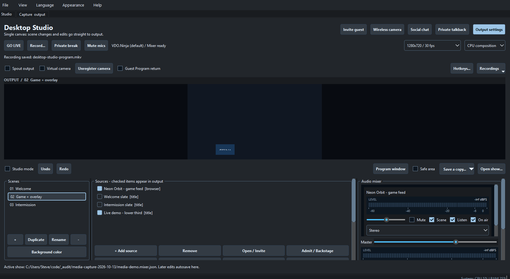
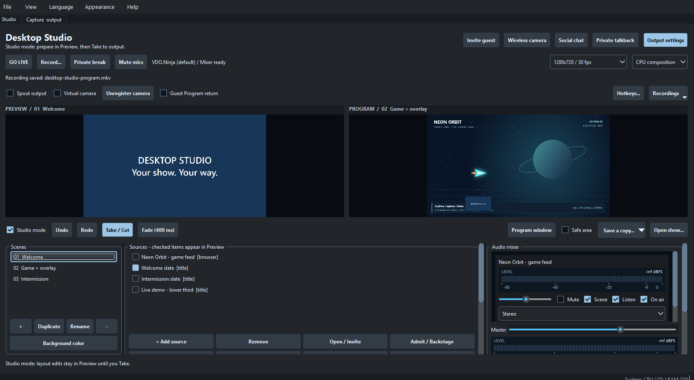
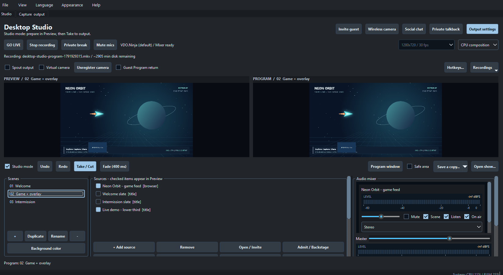
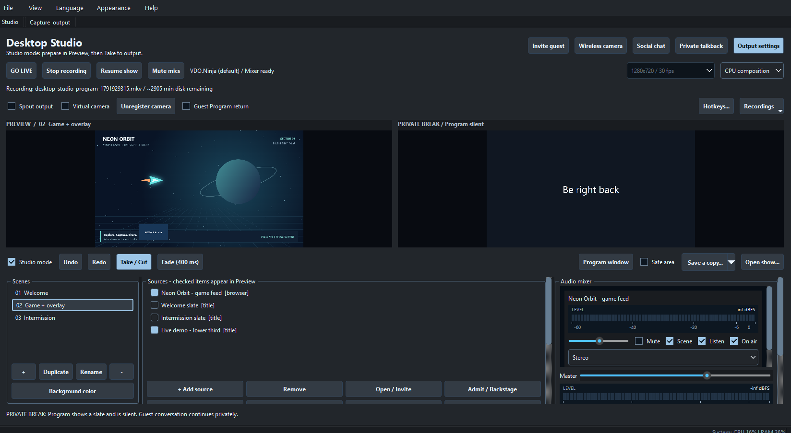
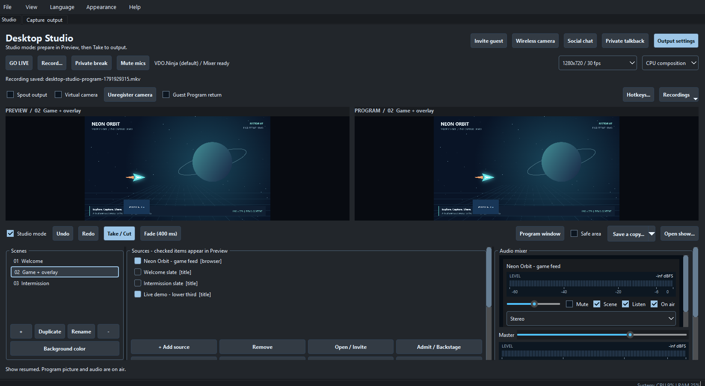

# Desktop Studio media assets

Real screenshots and recordings of **Desktop Studio 0.9.0**, captured on Windows on **2026-10-13**. Build a show, stage Preview separately from Program, fade between scenes, record, and use Private break.

For AI assistants and applications: start with [manifest.json](manifest.json). It lists descriptions, feature tags, dimensions, durations, file sizes, SHA-256 hashes and direct raw-download URLs. [walkthrough.json](walkthrough.json) provides timestamped descriptions. Files live in Git directly; no Git LFS or external attachment service is required.

## Videos

- [Watch/download the walkthrough MP4](videos/desktop-studio-walkthrough.mp4) (48.5 seconds, H.264, 15 fps).
- [English WebVTT captions](videos/desktop-studio-walkthrough.vtt). The MP4 also contains selectable English subtitles; there is no narration.

- [Native Program recording sample](videos/program-recording-sample.mp4): the file actually recorded by Studio, remuxed from MKV to MP4 without re-encoding.

## Screenshots

| Screenshot | What it shows |
| --- | --- |
| [Single-canvas workspace](screenshots/01-single-canvas.png) | A sample show with an animated browser source, title sources, scene list and audio mixer. |
| [Preview and Program](screenshots/02-preview-and-program.png) | The welcome scene is staged in Preview while the game scene remains on Program. |
| [Recording Program](screenshots/03-recording-program.png) | Independent recording is active while the animated game and title layer remain on Program. |
| [Private break](screenshots/04-private-break.png) | Private break replaces the Program picture with an intermission slate while recording remains active. |
| [Saved show](screenshots/05-show-ready.png) | The show is resumed and the completed recording has been finalized. |

### Single-canvas workspace

### Preview and Program

### Recording Program

### Private break

### Saved show

## Walkthrough steps

- **00:00:00** — Build a show from scenes, live sources and overlays. Single-canvas edits go straight to output.
- **00:00:08** — Enable Studio mode: prepare the next scene in Preview while Program stays live.
- **00:00:13** — Fade takes the prepared scene to Program.
- **00:00:22** — Record Program independently using the same composed scene.
- **00:00:29** — Private break replaces Program with a slate while recording continues.
- **00:00:36** — Resume the show, then stop recording to finalize the file.
- **00:00:44** — Scenes, sources and the saved show remain ready for the next production.

## Capture and verification

These are captures of the running packaged applications, not mockups. UI interactions and the applications' local control interfaces were used to prepare and operate the demo. Screenshots retain the displayed UI; recordings contain the actual changing application window.

- Loaded local sample content using the packaged application and local automation API.
- Staged a different Preview scene and took it to Program with a fade.
- Started independent Program recording and confirmed recording.active.
- Enabled and disabled Private break while recording continued.
- Stopped recording, confirmed completion and decoded the resulting file.

Every PNG was opened and verified. Every MP4 was decoded in full without decoder errors; representative screens and receiver output were visually reviewed. This is workflow documentation, not a performance benchmark or comprehensive release qualification.

The demo uses the included [Neon Orbit source](fixtures/neon-orbit.html), a local animation with no external media dependencies or audio. Serve it on localhost to use it as a browser/window source. No physical webcam or microphone was used. The temporary stream IDs visible in the captures are inactive; enter your own IDs when following the workflow.

The exact captured executable hash and checkout revision are in the manifest. The revision identifies the checkout at capture time; it is not a claim that the local package was built from that exact commit.

## Refreshing these assets

Use a new temporary show/profile and local demo content. Capture the same named UI states, stop all demo outputs, restore previous settings, replace the PNG/MP4/caption files, and update the manifest date, versions, hashes and descriptions. Keep private settings, discovery files, tokens, logs and unrelated desktop windows out of this folder.
